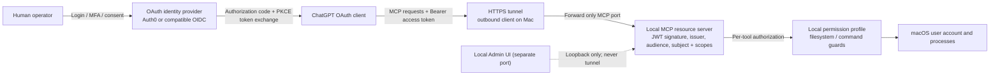

# Local ChatGPT Plus

A self-hosted MCP server that lets ChatGPT inspect and edit local code, run tests and commands, manage Git, and use additional agent workflows on macOS.

The **core coding workflow** stays simple: explore → read → patch → verify → review. Advanced features remain available, including persistent tasks, coding loops, context capsules, edit transactions, rewind, LSP, PTY, subagents, upstream MCP, and browser/desktop computer use.

## Requirements and quick start

- macOS, Node.js **22.22.2+**, npm; Git for Git-related tools.
- An HTTPS tunnel if connecting a hosted ChatGPT client to the local server.

```bash
# From a checkout containing this macOS edition:
cd /path/to/local-chatgpt-plus
cp .env.example .env
node -e "console.log(require('crypto').randomBytes(24).toString('base64url'))"
# Copy the printed secret into MCP_TOKEN= in .env.
# Set WORKSPACE_PATH to an isolated workspace in .env.
# Configure explicit workspace permissions (the example is not an OS sandbox):
cp profiles/permissions.example.json profiles/permissions.json
# Set PERMISSIONS_CONFIG=profiles/permissions.json in .env.
npm ci
npm start
```

The local MCP server defaults to `http://127.0.0.1:3000`; check `http://127.0.0.1:3000/health`. The optional **Admin UI** is available at `http://localhost:3001/ui/` when enabled and **requires a locally generated `ADMIN_TOKEN`** for bootstrapping and recovery. On macOS, you can also enroll a [Touch ID / Apple Passwords passkey](docs/ADMIN_PASSKEYS.md) for routine Admin login. Passkeys are bound to `localhost` (not numeric `127.0.0.1`); the Admin server still binds to loopback. Browser access requires an HttpOnly same-site cookie **and** a separate origin-scoped session proof (because localhost cookies cross ports), plus CSRF on writes; local automation may use a Bearer token. The new-install defaults disable Admin and ChatGPT auto-approval. Enabling Admin also enables its settings and upstream OAuth callback endpoints. Never tunnel Admin. The terminal dashboard starts automatically in an interactive terminal; set `LOCAL_CODER_TUI=off` for normal logs.

**Security:** Set `MCP_TOKEN` before exposing port 3000 through a tunnel. The default `workspace` permission profile narrows direct path parameters, but shell commands still run with the user's OS privileges; `WORKSPACE_PATH` changes the default directory but is **not a sandbox**. Never tunnel the Admin port, and keep the tokenized MCP URL secret. See [Security details](docs/OPERATIONS.md#security-details).

## Security model

For a freshly installed instance, inbound authentication is **token mode** unless
you explicitly configure OAuth. The reference deployment demonstrates **inbound
OAuth 2.1** with Auth0 and a Secure MCP Tunnel. Authentication, transport, and
local permissions are separate boundaries:



The OAuth provider is **not** the MCP server, and the tunnel is **not** the
authorization system. In token mode the browser OAuth flow is absent and a
nonempty random URL-path secret replaces Bearer JWT validation. In either mode,
Admin authentication is a **separate** loopback-only boundary. Even with OAuth and scoped paths, executing arbitrary
shell commands is **not OS-sandboxed**. For setup by another agent, follow
[Agent-assisted installation](docs/OPEN_SOURCE_SETUP.md); for the publication
checklist, see [Release security gates](docs/OPEN_SOURCE_RELEASE_SECURITY.md).

- **Inbound OAuth (Auth0):** The MCP resource server validates audience-bound
  access tokens (JWKS/`jose`), enforces scopes **per tool** (fail closed), and
  requires a valid `mcp:connect` base scope for every operation. A token lacking
  a tool's required scope is refused with a clear error. The live deployment runs
  `INBOUND_AUTH_MODE=oauth` with an Auth0 identity provider and a CIMD-registered
  ChatGPT client; the grant is scoped to the capabilities actually authorized.
  See the [Inbound OAuth guide](docs/INBOUND_OAUTH_GUIDE.md).
- **Secure MCP Tunnel:** Keeps port 3000 private and forwards requests from
  OpenAI's authorized tunnel endpoint to the Mac. The tunnel client
  authenticates with its **own runtime API key**, stored locally.
- **Runtime authorization:** The deployment uses a **workspace-scoped permission
  profile** (`profiles/permissions.deploy.json`) that binds file paths and shell
  cwds to the disposable workspace root. Opting into the `open` profile is much
  broader.
- **Not an OS sandbox:** Shell execution is application-level policy. `WORKSPACE_PATH`
  and the workspace profile restrict declared paths and default cwds, but they do
  **not** stop a shell command from reading or sending data outside the root. Never
  tunnel the localhost Admin UI on port 3001.

**Fallback — tokenized “No authentication” (the default for a fresh checkout):**
With `INBOUND_AUTH_MODE=token` (or unset) the server gates `/mcp/<MCP_TOKEN>` by a
local static bearer secret; the tokenized route exists and OAuth metadata is not
served. This is the documented fallback when the OAuth provider is not configured.
`MCP_TOKEN` must always be set before exposing port 3000 through any tunnel; keep
the tokenized URL secret.

## Connect ChatGPT

**Currently deployed (recommended): OpenAI Secure MCP Tunnel + OAuth (Auth0).**
The server runs `INBOUND_AUTH_MODE=oauth`; ChatGPT authenticates through Auth0,
consents to the scopes your CIMD client grant allows, and calls MCP tools with an
audience-bound access token. The workspace permission profile keeps paths/cwds
inside the disposable root. Full setup and cutover steps:
[Tunnel options → OpenAI Secure MCP Tunnel](docs/OPERATIONS.md#tunnel-options) and
the [Inbound OAuth guide](docs/INBOUND_OAUTH_GUIDE.md).

1. Start the server (`npm start`) and run `tunnel-client run --profile-file ~/lcp-tunnel.yaml`.
2. In ChatGPT Plugins → **Add custom MCP server**, enter the name/description,
   pick **Connection: Tunnel**, select the provisioned tunnel, and choose
   **Authentication: OAuth**.
3. Complete the Auth0 login, MFA, and **consent** — this binds the granted
   scopes (`mcp:connect`, `files:read`, `files:write`, `commands:execute`, …) to
   the access token. The resource server enforces those scopes per tool.
4. Install/enable the plugin. `@Local ChatGPT Plus` in a chat before asking it to
   work on files. Reconnect or start a new chat after a server/tunnel restart, and
   reauthorize the connector when you change its granted scopes.

**Fallback — tokenized “No authentication” (fresh-checkout default):** with
`INBOUND_AUTH_MODE=token`, in the ChatGPT form choose **No authentication** (the
tunnel is the transport boundary; the local `MCP_TOKEN` still gates the server).
A public HTTPS endpoint is an alternative when a Secure MCP Tunnel is not
available: expose port 3000 with a trusted HTTPS tunnel (e.g. `npm run tunnel`
Cloudflare Quick Tunnel) and set the connector URL to
`https://<your-tunnel-host>/mcp/<MCP_TOKEN>`. An empty `MCP_TOKEN` causes startup to fail in token mode except for explicitly
marked, loopback-only automated test fixtures; there is no unauthenticated
production endpoint.

A successful connection exposes the native MCP tools chosen by `CHATGPT_TOOL_PROFILE` (`slim` by default, `full` for every native tool). Individual tools can also be enabled or disabled from Admin. The source of truth is `src/lib/tool-profile.ts`; the regression check is `scripts/test-tool-profile.mjs`.

## Manual ON/OFF control and access modes (`lcp`)

The `lcp` controller turns the Local ChatGPT Plus server **and** the Secure MCP
Tunnel on/off together as per-user `launchd` jobs, independent of the terminal
or OMP that launched them. Install with:

```bash
scripts/lcp-install.sh      # installs ~/.local/bin/lcp and writes per-user config
lcp on                      # start (default: Workspace mode)
lcp off                     # stop both services and disable auto-restart
lcp status                  # state, health, ownership, current access mode
lcp restart [--mode <m>]    # controlled restart (preserves mode unless overridden)
lcp toggle                  # OFF→ON(Workspace) / ON→OFF; refuses PARTIAL; never Full
lcp mode <workspace|projects|full>   # safe controlled switch
lcp migrate                 # take over legacy OMP/terminal-owned processes
```

Nothing auto-starts at login: the service definitions live in
`~/.local/lcp/launchd/` (outside the auto-loaded LaunchAgents folders) and are
bootstrapped only by `lcp on`. While ON, `launchd` supervises and restarts a
job after an unexpected crash; `lcp off` fully unloads both jobs. See
[docs/OPERATIONS.md#controller-lcp-lifecycle-consistency-2026-11-20](docs/OPERATIONS.md#controller-lcp-lifecycle-consistency-2026-11-20).

### Access modes

| Mode | Command | Profile | Direct filesystem roots | Notes |
|---|---|---|---|---|
| **Workspace** | `lcp on` (default) | `workspace` | Operator-selected disposable workspace | Writes+commands allowed, unsafe runtimes blocked |
| **Projects** | fresh: `lcp on --mode projects`; switch: `lcp mode projects` | `custom` (multi-root) | Operator-configured project directories | Direct tools restricted to selected folders; unsafe runtimes still blocked |
| **Full / YOLO** | `lcp on --mode full` | `open` | unrestricted (OS ACLs still apply) | Deliberate, interactive-confirmation opt-in; unsafe runtimes enabled |

`lcp on` starts in **Workspace** when the server is OFF. If the server is already
ON, an ordinary `lcp on` (or `--mode <m>`) that requests a mode different from
the actual running profile **refuses** (nonzero exit) rather than silently
relabelling it — the stored mode can no longer disagree with the runtime profile.
Use `lcp mode <workspace|projects|full>` to switch, and `lcp status` to see the
stored vs actual runtime mode and whether they agree. `lcp off` **fails closed**:
it only succeeds after both launchd jobs are unloaded and ports 3000/3001/8090
have stopped listening, reporting `ERROR — OFF incomplete` and the remaining
listener/job otherwise. Only `--mode full` enables Full/YOLO, and only after
explicit interactive confirmation (`LCP_FULL_CONFIRM=1` for scripted use).
Authentication (Auth0), OAuth scope checks, and tunnel isolation stay enabled in
every mode. **These profiles are application-level policy, not an OS sandbox** —
a permitted shell command can read/send data outside the configured roots.

macOS Shortcut import files for ON/OFF/Toggle/Status/Projects are generated by
`scripts/gen-shortcuts.sh` into `shortcuts/` (import by double-clicking each
`.shortcut` and choosing **Add Shortcut**). The Projects Shortcut calls
`lcp mode projects` so it switches from an already-ON deployment. Full/YOLO
deliberately has **no** shortcut: it requires the interactive `YES`
confirmation, so it stays Terminal-only.

## Capabilities

| Area | Examples |
|---|---|
| Explore and edit | `glob`, `grep`, `read_text_file`, `apply_patch`, `write_file` |
| Run and verify | `run_command`, `start_process`, `verify_project`, `pty` |
| Repository workflows | `git_status`, `git_diff`, `git_commit`, `git_worktree`, `repo_intel` |
| Recover work | `rewind`, `agent_task`, `coding_loop`, `edit_transaction`, `context_capsule` |
| Extend the agent | Skills, LSP, subagents, upstream MCP servers, browser/desktop MCP integrations |
| Observe and configure | Interactive TUI, localhost Admin UI, audit and recovery diagnostics |

These features are intentionally retained even when they are not used during every coding session. Consult the [detailed operations guide](docs/OPERATIONS.md) for configuration, safety controls, permissions, recovery behavior, and the full tool reference.

## Configuration

Copy `.env.example` to `.env` and adjust only the settings you need. Common options:

| Variable | Purpose |
|---|---|
| `WORKSPACE_PATH` | Default working directory (not a permission boundary) |
| `MCP_TOKEN` | Secret included in the MCP connector URL |
| `CHATGPT_TOOL_PROFILE` | `slim` or `full` |
| `LOCAL_CODER_ADMIN_ENABLED` | Enable/disable the localhost Admin UI |
| `LOCAL_CODER_TUI` | `auto`, `on`, or `off` |
| `PERMISSIONS_CONFIG` | Configure application-level filesystem/command restrictions |
| `MCP_UPSTREAM_CONFIG` | Configure external MCP servers |

More environment variables and advanced workflows are documented in [the configuration reference](docs/OPERATIONS.md#configuration-reference).

## Dashboard (Admin UI) usage

The Admin UI is localhost-only (`http://127.0.0.1:3001/ui` by default); it stops
being reachable when the server is OFF. To watch live agent activity:

1. Turn Local ChatGPT Plus on (`lcp on`). From an interactive terminal `lcp on`
   opens the Admin dashboard automatically once the Admin UI is ready (disable
   with `LCP_OPEN_DASHBOARD=0`; headless/daemon/`lcp restart|mode|toggle` never
   auto-open, so nothing steals focus).
2. Open `http://localhost:3001/ui/`. Sign in with your private Admin recovery token, or [enroll/use an Apple Passwords passkey](docs/ADMIN_PASSKEYS.md) for future sign-ins.
3. Open the **Activity** tab and keep **Live** enabled.
4. Make a tool call from ChatGPT — it appears in the feed with a friendly
   description, status, duration, and sanitized expandable details, and any
   currently-running call appears under **Running now**.
5. The **Overview** tab's **Recent tool calls** rows are keyboard-accessible
   disclosure buttons (and whole-row clickable) that expand to sanitized
   technical details (start/end timestamps in Europe/Berlin with CET/CEST —
   missing/invalid times show "Time unavailable" — duration, result size,
   session, project, workspace, error). Open/closed state survives the 5s
   auto-refresh.
6. Use the kind/status/search filters; **Clear view** clears only the local view
   without deleting durable audit records.
7. The **Missions** tab shows the persistent agent-task registry as a
   task-first board (goal, project, source, status, current step, last
   activity, blocked/"needs attention") and offers **Copy handoff instructions**
   for a human-initiated ChatGPT-to-ChatGPT handoff that shares the same
   mission id through this MCP plugin.

Activity, audit, and telemetry fields are **sanitized server-side**: sensitive
values (tokens, API keys, passwords, cookie/credential/env values and raw
payloads) are redacted or dropped before they reach the API response, the SSE
stream, or the durable audit file.

### Task status versus live execution

Saved `agent_task` plans are not autonomous workers. `agent_task get/list/resume` and the Admin Missions board show an independent `execution.state`, last linked worker outcome, recovery guidance, and warnings when Git commits are newer than recorded plan progress. Use `task_id` when launching task-associated `subagent` or `start_process` workers. Unambiguous model-agent launches may inherit a task ID across Git worktrees; ambiguity is never guessed. `verify_project(task_id=...)` saves a verification receipt but does not automatically finish plan steps. Stalled workers require explicit inspection/resumption; LCP never silently replays them.

## Development and verification

```bash
npm run build
npm test
npm run test:smoke        # read-only fail-closed security pre-flight (fast)
npm run test:integration
npm run test:all
```

The smoke check (`npm run test:smoke`) asserts that Auth0 token-vs-oauth config
validation, Admin loopback isolation, permission-profile fail-closed, path/
symlink escapes, upstream allowlist, and headless-approval denial all fail
closed, plus a native PTY / language-server smoke when the dependency is
installed. It uses only disposable dirs and never touches live state.

The snapshot is **not** a live macOS/tunnel/Auth0/GUI test. The local suite
(including `test:smoke`) proves the code's fail-closed behavior in isolation; a
real Auth0 consent, a live Secure MCP Tunnel reconnect, and an interactive macOS
approval dialog can only be exercised on an actual Mac in an authorized
maintenance window. See
[Verification: local smoke vs live maintenance-window validation](docs/OPERATIONS.md#verification-local-smoke-vs-live-maintenance-window-validation)
and [MAINTENANCE_BACKLOG.md](MAINTENANCE_BACKLOG.md) for maintainability and
security follow-ups. Do not mark P0.5/P0.6 complete on isolated evidence alone.

## Troubleshooting

| Problem | First check |
|---|---|
| Connection fails or returns 404 | Server and HTTPS tunnel running; connector URL includes `/mcp/<MCP_TOKEN>` |
| ChatGPT cannot see tools | Enable/tag the connector; refresh after a server update |
| Permission denied | OS permissions and the Local ChatGPT Plus permission profile |
| Admin UI unavailable | Check `LOCAL_CODER_ADMIN_ENABLED` and `ADMIN_PORT` |
| Build or test fails | Use the exact error, check Node version and installed dependencies; **do not delete `.mcp-state` blindly** |

See [extended troubleshooting](docs/OPERATIONS.md#extended-troubleshooting) for long-running sessions, errors, and recoverable state.

## Documentation and attribution

- [AGENTS.md](AGENTS.md) — detailed coding-agent operating instructions and safe workflows
- [Operations guide](docs/OPERATIONS.md) — advanced features, Admin UI, TUI, tunnel setup, configuration, and troubleshooting
- [Security policy](SECURITY.md) — vulnerability reporting, scope and safeguards
- [Maintenance backlog](MAINTENANCE_BACKLOG.md) — validation, vulnerability audit, and evidence-based optimization tasks
- [Agent-assisted installation](docs/OPEN_SOURCE_SETUP.md) — reusable agent prompt, safe defaults, and manual authentication/tunnel steps
- [Release security gates](docs/OPEN_SOURCE_RELEASE_SECURITY.md) — threat model, required checks, unresolved risks, and publication checklist
- [Provenance and security audit](docs/PROVENANCE_SECURITY_AUDIT.md) — inherited-code, licensing, asset, and secret-review findings
- [Inbound OAuth implementation spec](docs/INBOUND_OAUTH_IMPLEMENTATION_SPEC.md) — the OAuth 2.1 end-user authentication and per-tool authorization specification
- [Inbound OAuth guide](docs/INBOUND_OAUTH_GUIDE.md) — implemented resource-server auth, mode switch, configuration, provider options, and ChatGPT cutover

This independent project derives from MIT-licensed **ChatGPT Local Coder** by hoangcoderr. The original copyright and permission notice remain in [LICENSE](LICENSE).