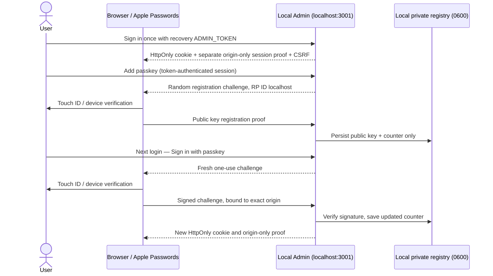

# Local Admin passkeys on macOS (WebAuthn)

Passkeys are optional, phishing-resistant credentials for the **local Admin UI only**. They are distinct from the inbound MCP OAuth flow and do not change the ChatGPT connector, tunnel, or MCP tool permissions.

## Apple Passwords / iCloud Keychain enrollment

1. Ensure Admin is enabled on the **loopback-only** address with a randomly generated `ADMIN_TOKEN`. **Never expose port 3001 through a tunnel.**
2. Open **`http://localhost:3001/ui/`** in a supported browser (Safari on macOS is recommended). The **`localhost` hostname is required**: a WebAuthn passkey cannot use a numeric IP-address RP ID such as `127.0.0.1`. `http://localhost` is a browser-trusted WebAuthn context.
3. Sign in once with your existing Admin recovery token. If the token is in your private per-user runtime file, the following copies it to the macOS clipboard without displaying it:
   ```bash
   sed -n 's/^ADMIN_TOKEN=//p' ~/.local/lcp/state/private-runtime.env | pbcopy
   ```
   Paste it into the Admin login dialog; clear the clipboard afterward.
4. Click **Add passkey**. Follow Safari/Apple Passwords to save a credential (Touch ID or macOS login password/device verification may be requested). **The Mac or browser's credential provider stores the private key; the server stores only its public key and signing counter.**
5. Sign out. On the same `http://localhost:3001/ui/` origin, select **Sign in with passkey**. No Admin token needs to be typed for routine logins.

Whether a passkey is saved to Apple Passwords/iCloud Keychain or another credential provider depends on the browser and your macOS settings. This does not attempt to copy or export any private passkey material.

## How it works



The server enforces the exact **`http://localhost:3001` origin** (including port), RP ID `localhost`, a one-time 120-second challenge, and user verification. A different origin, missing user verification, or a reused challenge is rejected. Login challenges use signed, HttpOnly, short-lived cookies with a bounded replay cache, avoiding any unauthenticated issued-challenge FIFO that another local process could evict; the signing key and replay cache are process-local.

Passkeys authenticate the Admin **browser**. Admin browser sessions also require an independently random proof sent in an HTTP header and held in **origin-scoped sessionStorage**: a stolen `localhost` cookie alone is useless, even though cookies are shared across localhost ports. New tabs without the proof must sign in again. The Admin server does not persist the proof; browser session storage is isolated by origin but may be restored by the browser after a crash. Local automation may continue to use the Admin token in a Bearer header; it does not need access to the passkey private key.

## Recovery, revocation and privacy

- **Keep `ADMIN_TOKEN` as the recovery method.** Enrolling a passkey does not disable it. This is deliberate: losing the passkey or switching Macs should not lock out the administrator. Store the recovery token separately and securely.
- To register another passkey or revoke an existing one, sign in using the Admin **token** rather than passkey login. Click **Manage passkeys** to revoke the public credential on the server; revocation also invalidates any existing passkey-authenticated browser sessions. If necessary, remove the matching saved passkey from Apple Passwords as a separate manual step.
- The default server-side registry is `~/.local/lcp/state/admin-passkeys.json` (**mode 0600**, with state directory restricted to the user). Only one Admin process may hold its private registry lock at a time; an orphaned lock from a confirmed-dead process is recovered. Override the path only with a secure absolute `ADMIN_PASSKEY_FILE` for tests/advanced setups. Never commit either file, expose it from Admin responses, or place it inside the public repository.
- The registry stores an opaque user handle, credential IDs, **public keys**, counters, optional transports and enrollment timestamps. It contains **no Apple private key, password, Admin token, credential signing secret or biometric data**.
- If the registry is lost, passkey login stops working; sign in with the token and enroll again. If the Admin token is rotated, old browser sessions are invalidated but registered passkeys remain until revoked.
- **Security limitation:** The Admin port is loopback-only, but malware running under the same macOS account may already access local files and processes. Passkeys do not sandbox local shell tools or replace the separate MCP OAuth authorization boundary.

## Test and deployment notes

```bash
pnpm install --frozen-lockfile --ignore-scripts
pnpm audit signatures
pnpm rebuild
pnpm run build
node scripts/test-admin-passkeys.mjs
pnpm test
```

The passkey test uses a **synthetic FIDO2 P-256 authenticator** to verify actual registration signatures, exact-origin and user-verification enforcement, challenge replay denial, persisted 0600 metadata, and token-session-only revocation. It does **not** enroll a real Touch ID credential, touch Apple Passwords, or affect the existing installed MCP service.

After a reviewed PR is merged and deployed, physically enroll the first passkey in Safari. Until that human step, the **existing Admin token works exactly as before**, and the sign-in button is hidden when no credential exists.
