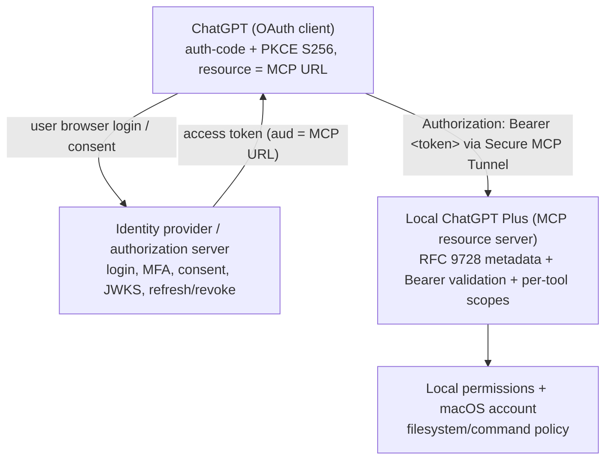

# Inbound OAuth 2.1 for Local ChatGPT Plus — implementation & operations guide

**Status:** Implemented, locally verified, and **live** (see
`docs/CHATGPT_MCP_DEPLOYMENT_REPORT.md`). The resource-server side (discovery,
audience-bound token validation, per-tool scopes, fail-closed mode switch, PKCE
flow) is complete and covered by an automated suite
(`scripts/test-inbound-oauth.mjs`). The live cutover (2026-11-20) uses Auth0 as
the identity provider: a real ChatGPT conversation authenticated through Auth0
and made successful MCP tool calls. Root-cause note: an empty
`INBOUND_OAUTH_ALLOWED_ALGORITHMS` allowlist was being treated as "deny all"
(`[] ?? default` → `[]`), which rejected every token with
`"alg" (Algorithm) Header Parameter value not allowed`; the verifier now treats
an empty/absent allowlist as `["RS256","ES256"]`.

This is an **inbound** OAuth resource-server integration for the ChatGPT client.
It is unrelated to the existing outgoing upstream-OAuth *client* module
(`src/lib/mcp-oauth-provider.ts`), which is used only when Local ChatGPT Plus
calls *other* MCP servers.

## Architecture



- **Client:** ChatGPT performs the OAuth authorization-code + PKCE S256 flow.
  It discovers the resource server's protected-resource metadata, redirects the
  user's browser to the identity provider for login/MFA/consent, exchanges the
  code for an access token, and sends it as a Bearer token over the Secure MCP
  Tunnel.
- **Identity provider (authorization server):** owned/operated by the user
  (a hosted IdP is recommended). Serves RFC 8414 metadata, JWKS, authorization/
  token endpoints, and signs audience-bound JWTs (`aud` = the MCP resource URI).
  It is reachable by the user's browser *and* by ChatGPT's server-side token
  exchange independently of the tunnel.
- **Resource server (this project):** advertises RFC 9728 protected-resource
  metadata and the RFC 8414 authorization-server metadata; validates every MCP
  request's Bearer token (signature/issuer/audience/`exp`/`nbf`/`iat`/algorithm/
  subject allowlist); enforces scopes **per tool**; refuses unauthenticated or
  insufficiently-scoped calls. Tokens are validated statelessly on every request,
  so an expired, future-`iat`, or lowered-scope token cannot survive into a later
  request. Individual-token **revocation** is not detected per-token (stateless
  JWTs have no blocklist/introspection); it is honored only when a signing key
  is rotated, with latency bounded by the JWKS cache TTL.

## Auth modes (fail-closed switch)

`INBOUND_AUTH_MODE` selects the inbound authentication boundary:

| Mode | Behavior | MCP endpoint |
|------|----------|--------------|
| `token` *(default)* | **Baseline, unchanged.** `MCP_TOKEN` URL-path bearer; unguarded paths return 404; no OAuth discovery. | `/<MCP_TOKEN>` and `/mcp/<MCP_TOKEN>` |
| `oauth` | Inbound OAuth resource server. Every MCP operation requires a valid, audience-bound Bearer token with the `mcp:connect` base scope. The tokenized route **does not exist** (no OAuth bypass). RFC 9728/8414 metadata is served for discovery. | `/mcp` and `/` |

In `oauth` mode the server **fails closed at startup** if required configuration
is missing or the issuer is unreachable — it refuses to start an unauthenticated
MCP server rather than silently dropping a layer. `MCP_TOKEN` is ignored in
`oauth` mode (and a warning is printed).

### Configuration (`oauth` mode)

```env
INBOUND_AUTH_MODE=oauth
INBOUND_OAUTH_ISSUER=https://<your-idp-tenant>          # required; RFC 8414 issuer
INBOUND_OAUTH_RESOURCE_URI=https://<tunnel-host>/mcp    # required; external canonical MCP URL (token audience)
INBOUND_OAUTH_ALLOWED_SUBJECTS=<idp-subject>            # required; intended account (semicolon-separated)
INBOUND_OAUTH_JWKS_URI=                                  # optional; overrides discovery
INBOUND_OAUTH_ALLOWED_ALGORITHMS=RS256;ES256             # optional
INBOUND_OAUTH_CLOCK_SKEW_SECONDS=30                      # optional
INBOUND_OAUTH_JWKS_CACHE_TTL_MS=300000                   # optional; key rotation/revocation latency
INBOUND_OAUTH_DISCOVERY_TIMEOUT_MS=10000                 # optional
INBOUND_OAUTH_RESOURCE_NAME=Local ChatGPT Plus MCP       # optional; shown in protected-resource metadata
```

`INBOUND_OAUTH_RESOURCE_URI` is the exact HTTPS URL ChatGPT uses as the MCP
server URL (the Secure MCP Tunnel endpoint + `/mcp`). The identity provider must
place that value in the access token's `aud` claim (RFC 8707 resource indicator /
audience parameter) — the resource server rejects any token whose audience is
not this resource, which also forbids reusing a token against any other MCP
resource.

The `INBOUND_OAUTH_ALLOWED_SUBJECTS` value comes from the identity provider and
identifies your single human account (the `sub` claim). Without it the server
refuses to start, so a ChatGPT account alone can never authorize the machine.

## Scope taxonomy and per-tool enforcement

Scopes are coarse capability buckets the user consents to once during login.
The resource server advertises them in protected-resource metadata and checks
**every `tools/call`** against them (native tools and upstream `<server>__<tool>`
proxies), not just `tools/list`.

| Scope | Grants |
|-------|--------|
| `mcp:connect` | Base: every MCP operation (initialize, tools/list, …) |
| `files:read` | Read-only filesystem/project inspection |
| `files:write` | Filesystem + durable coding-state mutation (write/edit/delete/restore) |
| `commands:execute` | Shell/process/Git/PTY/upstream execution |
| `computer:use` | Desktop/browser computer-use automation (`computer_observe`/`computer_act`) |

Per-tool mapping lives in `src/lib/inbound-oauth/scopes.ts`. The runtime tool
kind (READ/EDIT/EXEC/MCP) — the same classification already used for telemetry
and the unsafe-runtime gate — drives the required scope, so upstream proxies are
conservatively command-scoped. Overrides cover computer-use and durable-state
tools (`agent_task`, `coding_loop`, `edit_transaction`, `context_capsule`,
`rewind`, `remember`, `mcp_call`).

A token that lacks a tool's required scope is refused with a clear error even
though the token is otherwise valid. This is in addition to — never a replacement
for — the existing local permission profiles and the macOS operator dialog for
sensitive computer-use actions.

## Security boundaries

- **Every relevant HTTP MCP operation** — initialize, `tools/list`, `tools/call`,
  GET/SSE, DELETE/session teardown — requires a valid Bearer token before any
  session or tool side effect. No reliance on tool annotations, front-end consent,
  or a cached session ID as proof of authorization.
- **Token validation:** signature against issuer JWKS, algorithm allowlist,
  `iss` == issuer, `aud` == resource URI, `exp`/`nbf`/`iat` with clock tolerance,
  and subject allowlist. ID tokens and other providers' access tokens are
  rejected by the audience/issuer checks.
- **Key rotation / revocation:** the JWKS cache (`INBOUND_OAUTH_JWKS_CACHE_TTL_MS`)
  bounds how quickly a rotated/revoked signing key is honored. Real-world
  revocation latency = cache TTL.
- **No OS sandbox change:** OAuth authenticates *who* may use the server; it does
  not sandbox shell commands. The existing permission profiles and macOS account
  limits still apply. `WORKSPACE_PATH` is not a sandbox.
- **Admin UI** remains on its own loopback port and is never tunneled.
- **Logging** redacts tokens and secrets (existing `[REDACTED_MCP_TOKEN]` handling
  covers the token path; access tokens are never written to logs).

## Identity-provider options (decision required)

The identity provider must support: authorization-code + PKCE S256, RFC 8414
metadata with JWKS, refresh (+ revocation preferred), MFA, restriction to one
account, and putting the MCP resource URI in the token audience (resource
indicators / `audience` parameter). It must be reachable by the user's browser
**and** by ChatGPT's server-side token exchange (the Secure MCP Tunnel does not
publish an authorization server).

| Option | MFA | PKCE S256 | JWKS | Resource/audience binding | DCR/CIMD | Maintenance | Cost |
|--------|-----|-----------|------|---------------------------|----------|-------------|------|
| **Auth0** (hosted) | ✓ (Guardian) | ✓ | ✓ | ✓ (`audience`) | DCR | Low (hosted) | Free tier (7.5k MAU) |
| **Okta** (hosted, developer) | ✓ | ✓ | ✓ | ✓ | DCR | Low–med | Free dev (1k MAU) |
| **Google Identity** | optional | ✓ | ✓ | ✗ (`aud` = client_id) | pre-register only | Low | Free |
| **Microsoft Entra ID** | ✓ (conditional) | ✓ | ✓ | ✓ | DCR | Med | Free tier |
| **Self-hosted AS** (`oidc-provider`/Keycloak) | DIY | ✓ | ✓ | ✓ | ✓ | High (operate + expose publicly) | Free infra |

**Chosen (user-approved): Auth0.** A hosted identity provider is the lowest
maintenance and the only low-effort path that gives true RFC 8707
resource/audience binding plus MFA. Google was not recommended because its
access tokens are audience-bound to the client id, not to the MCP resource URI,
which would weaken the audience check this implementation enforces. Self-hosting
was not recommended for a single-user personal server because the
authorization/token endpoints would need to be publicly reachable for ChatGPT's
token exchange, and you would own MFA and uptime.

### Auth0 setup (manual, user actions)

1. **Create an Auth0 tenant** (free tier supports a single user): manage.auth0.com.
2. **Create an application** for the ChatGPT MCP client. It performs the
   authorization-code flow with PKCE S256 and a server-side token exchange, so
   configure it as a Regular Web Application (or Native) with:
   - `authorization_code` + `refresh_token` grant types, PKCE enabled;
   - the **exact ChatGPT callback URL(s)** from the ChatGPT plugin form (do not
     invent these — read them from the real "Add custom MCP server" UI at
     cutover; no wildcards, no open redirects);
   - no client secret required for ChatGPT (public client, PKCE).
3. **Enable the resource/audience binding.** Create or use an **Auth0 API** whose
   **Identifier** is the external MCP resource URI (`INBOUND_OAUTH_RESOURCE_URI`,
   e.g. `https://<tunnel-host>/mcp`). ChatGPT must request that audience so the
   access token's `aud` equals the resource URI — the exact check this server
   enforces. Add the scope values (`mcp:connect`, `files:read`, `files:write`,
   `commands:execute`, `computer:use`) to the API.
4. **Enable MFA** (Guardian) for the tenant and require it for the user.
5. **Record the issuer URL** (`https://<tenant>.us.auth0.com/`) for
   `INBOUND_OAUTH_ISSUER` and your account's `sub` for
   `INBOUND_OAUTH_ALLOWED_SUBJECTS` (read from an ID token after first login).
6. **Register the ChatGPT client** with Auth0 — prefer ChatGPT Client ID
   Metadata Documents (CIMD) where supported, otherwise DCR or the explicit
   pre-registered application from step 2 using ChatGPT's real client id and
   callback URIs.
7. Confirm Auth0 publishes RFC 8414 metadata at
   `https://<tenant>.us.auth0.com/.well-known/oauth-authorization-server`
   (authorization/token endpoints + JWKS) and that its metadata includes
   `code_challenge_methods_supported: ["S256"]` and the token audience.

The exact callback URIs and client-id/redirect values must be read from the real
ChatGPT form at cutover; they are never invented here.

## ChatGPT configuration (OAuth) and first login

Only after the provider is provisioned and the local suite passes do you select
**Authentication: OAuth** in ChatGPT. The steps below assume the provider and the
`oauth`-mode server are ready.

1. **Register the ChatGPT client** with the identity provider. Record ChatGPT's
   client id and redirect URIs exactly (no wildcards, no open redirects). Prefer
   ChatGPT Client ID Metadata Documents (CIMD) where the provider supports it;
   otherwise DCR or an explicit pre-registered application using the real ChatGPT
   client id and callback URIs discovered from the ChatGPT plugin form.
2. **Configure `oauth`-mode env** (above). Point `INBOUND_OAUTH_RESOURCE_URI` at
   the tunnel's public MCP URL.
3. **Start** the MCP server and the Secure MCP Tunnel (see
   `docs/OPERATIONS.md` → Tunnel options). Confirm:
   `curl -s http://127.0.0.1:3000/health | jq .authMode` → `oauth`, and that
   `/.well-known/oauth-protected-resource/mcp` resolves through the tunnel.
4. In ChatGPT **Add custom MCP server**: **Connection: Tunnel** (existing tunnel),
   **Authentication: OAuth**.
5. **First login:** the user completes browser login at the identity provider,
   identity verification/MFA, and consent to the requested scopes. ChatGPT then
   exchanges the code and calls the MCP server with the access token.
6. **Verify:** a real chat exercises read, write, run-test, Git diff, a denied
   out-of-scope operation, expired-token refresh, and restart/reconnect. Confirm
   the token subject/scopes in the Mac's *redacted* server logs, and that the
   Admin port is never tunneled and a user without consent cannot use the tools.

## Testing (automated)

`scripts/test-inbound-oauth.mjs` (part of `npm test`) runs against a local test
authorization server that mirrors an external IdP (RFC 8414 metadata + JWKS +
PKCE S256 authorize/token). It covers:

- RFC 9728 protected-resource + RFC 8414 metadata discovery (served, and surfaced
  through the MCP path).
- Bearer validation: accepted valid token; missing header → `401` +
  `WWW-Authenticate: Bearer error="invalid_token", resource_metadata="…"`;
  forged/garbage, wrong-issuer, wrong-audience, expired, future-`nbf`, and
  wrong-subject tokens → `401`; missing base scope → `403 insufficient_scope`.
- Per-tool scope enforcement (native read/exec and computer-use override).
- Full PKCE S256 authorize → code → token flow, wrong `code_verifier` →
  `invalid_grant`, consent-deny → `access_denied`, refresh grant.
- Key rotation: removing a signing key from the JWKS invalidates its tokens.
- Fail-closed startup for missing issuer/resource/subjects.
- End-to-end: the real server in `oauth` mode guards `/mcp` (401 without token),
  serves discovery, and exposes no tokenized `/mcp/<token>` route.

## Rollback

`oauth` mode is opt-in. To return to the baseline, set `INBOUND_AUTH_MODE=token`
(and keep `MCP_TOKEN` set), restart, and re-connect ChatGPT with **No
authentication**. The tokenized `/mcp/<MCP_TOKEN>` route is restored and no OAuth
metadata is served. The baseline is fully preserved and is the default.

## Known limitations

- **Tunnel routing for discovery was confirmed at live cutover (2026-11-20).**
  The local server serves discovery at `/.well-known/oauth-protected-resource/mcp`;
  ChatGPT's backend reached the tunnel, discovered the Auth0 authorization
  server, ran the OAuth flow, and made live tool calls, so the Secure MCP Tunnel
  forwards the protected-resource discovery from the external resource URI.
- **Live ChatGPT cutover, identity-provider tenant/account, MFA/consent, real
  secrets, and production cutover** are user actions (the agent's stop-and-ask
  boundaries). The live OAuth cutover was completed with user interaction
  (login/MFA/consent); the verdict in the deployment report reflects this.